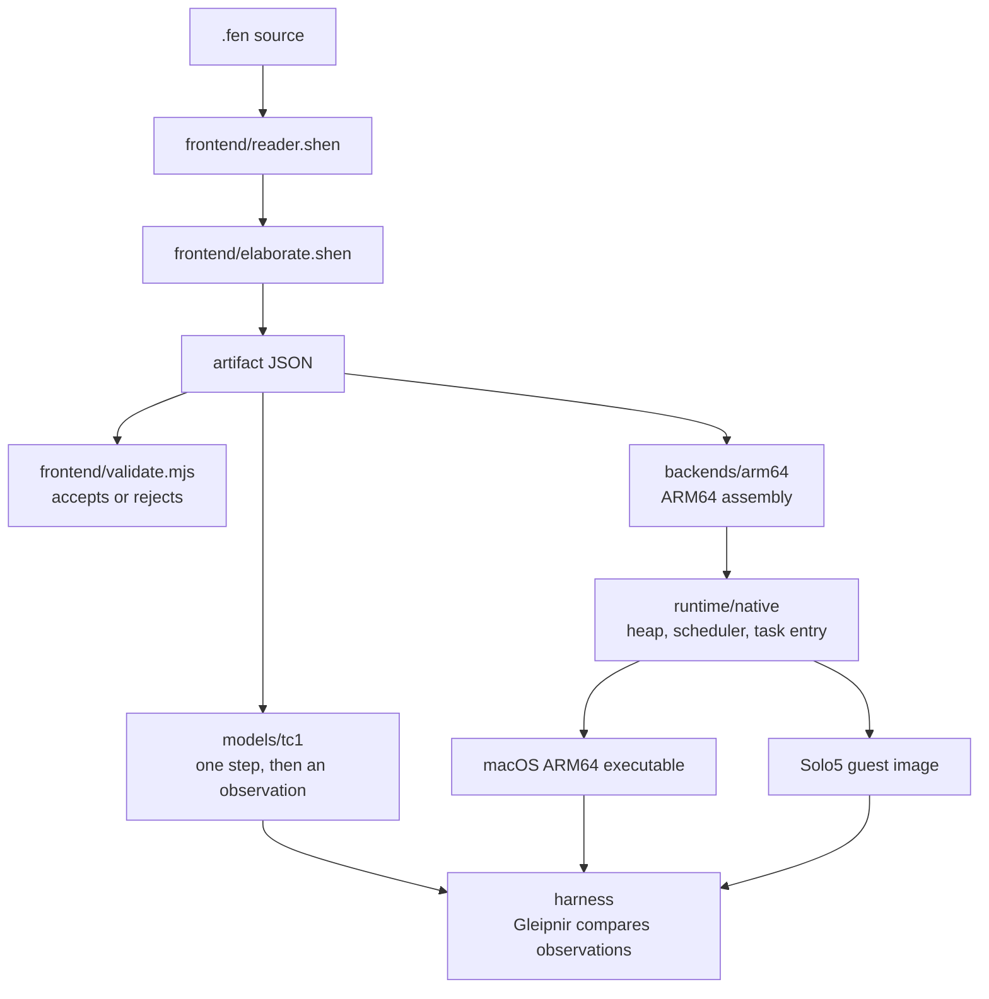
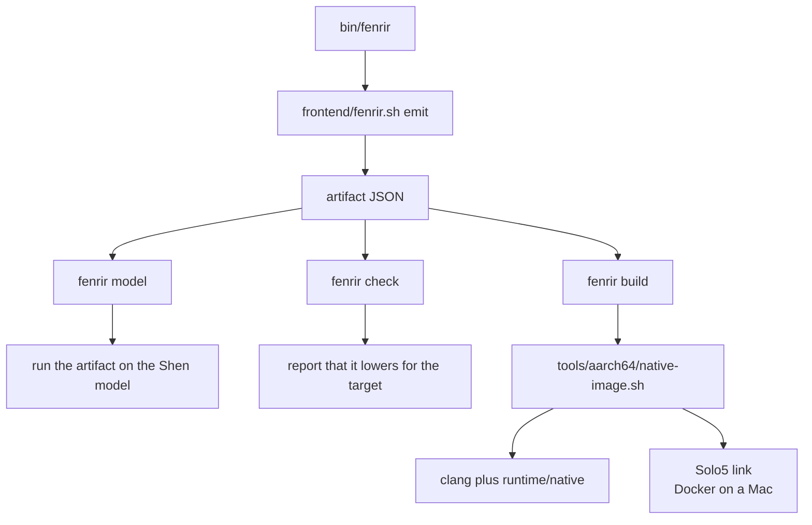
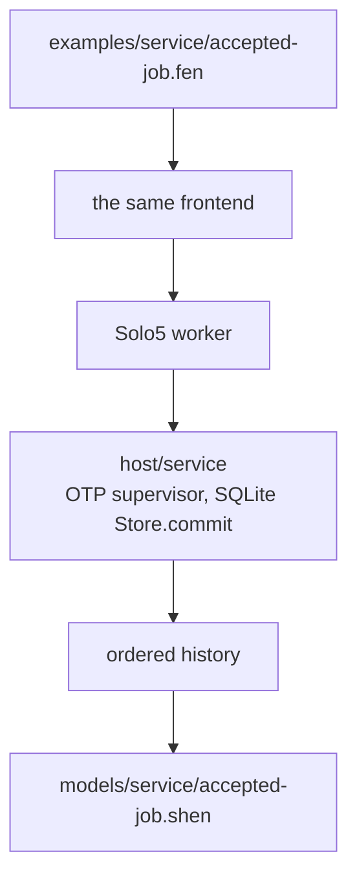
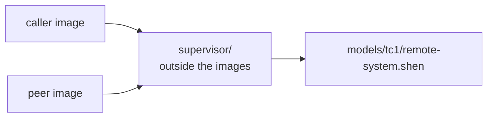

# Walk the repository

Fenrir is not an application with a `src/` tree. A `.fen` file is elaborated into JSON bytes. Two independent readers consume those bytes: a Shen machine that steps the rules, and a Shen compiler that emits ARM64. Gleipnir, in `harness/`, compares what they observe. When you are lost, you are usually in a directory that records a campaign, a measurement, or an older plan, rather than in that pipeline.

The same path is drawn in [walkthrough.html](walkthrough.html). Open that file in a browser from a checkout. This page is the version that renders on GitHub.

## If you open five files

| Order | File | What you are looking at |
| --- | --- | --- |
| 1 | [README.md](../README.md) | The claim, the cancellation table, and the durable `submit` snippet |
| 2 | [examples/recursive-sum.fen](../examples/recursive-sum.fen) | A whole program. `main` is the entry point |
| 3 | [frontend/main.shen](../frontend/main.shen) | The header: elaborate, then an independent validator, then the model. Nothing here interprets a program |
| 4 | [models/tc1/task-machine.shen](../models/tc1/task-machine.shen) | The header: task, scope, and channel state, and the fact that a schedule is an input |
| 5 | [bin/fenrir](../bin/fenrir) | `model`, `check`, and `build` all emit an artifact, then diverge |

## One source, two readers

`frontend/validate.mjs` judges the artifact and does not rewrite it. The model and the compiler read the same bytes.

The CLI is that fork with a shell around it.

`fenrir run` builds an image and then executes it. `fenrir record` and `fenrir replay` go through `tools/aarch64/native-replay.py`.

## A path through the tree

1. **The claim.** [README.md](../README.md). Two runs can return the same value and still disagree. The cancellation example returns `42` on both sides; the bug was an extra `child` event. That is why the harness compares ordered events, not only the result. The program is [tests/native/discontinue-joins-child.fen](../tests/native/discontinue-joins-child.fen).

2. **A program you can hold.** [examples/recursive-sum.fen](../examples/recursive-sum.fen). Then the other short files in [examples/](../examples): arithmetic, closures, handlers. Leave `examples/service/` and `examples/remote/` until the pipeline is familiar.

3. **How the text is spelled.** [spec/tc1/SURFACE.md](../spec/tc1/SURFACE.md), especially the status note and the three commands at the top. Meaning lives in the Shen model. The surface is a draft that elaborates into a versioned artifact schema. Effects, tasks, and durable requests are [EFFECTS.md](../spec/tc1/EFFECTS.md), [CONCURRENCY.md](../spec/tc1/CONCURRENCY.md), and [DURABLE.md](../spec/tc1/DURABLE.md). The standalone limits (16 live children) are [spec/native/standalone-v1.json](../spec/native/standalone-v1.json).

4. **Text becomes bytes.** [frontend/fenrir.sh](../frontend/fenrir.sh) is `check`, `run`, `emit`. [frontend/main.shen](../frontend/main.shen) loads [reader.shen](../frontend/reader.shen) and [elaborate.shen](../frontend/elaborate.shen), writes the artifact, and asks [validate.mjs](../frontend/validate.mjs) to judge those bytes. `typing/` is a separate Shen checker, used when `FENRIR_REQUIRE_SHEN_TYPING=1`. It is not the main path.

5. **The rules.** Read the header of [models/tc1/handler-machine.shen](../models/tc1/handler-machine.shen), then the header of [models/tc1/task-machine.shen](../models/tc1/task-machine.shen). The task machine adds scopes, channels, and cancellation; a step that is not one of those is the handler machine's step. [models/tc0/](../models/tc0) is the earlier pure-call machine, including the decimal I64 arithmetic. Open it when a TC0 gate is the question.

6. **The other reader.** [backends/arm64/emit.shen](../backends/arm64/emit.shen) parses the same JSON and selects instructions. [runtime/native/](../runtime/native) is the C heap, the managed runtime, and the scheduler. [tools/aarch64/native-image.sh](../tools/aarch64/native-image.sh) is what `bin/fenrir` calls before clang or the Solo5 link.

7. **Where disagreement is kept.** [harness/README.md](../harness/README.md). The harness and the model share one Shen process. A useful failure is a small program, a schedule, and the first observation that differs. Native regressions live in [tests/native/](../tests/native) as `.fen` files.

8. **What is settled.** [docs/design/04_DIRECTION_AMENDMENT.md](design/04_DIRECTION_AMENDMENT.md) §1 and §2. Where it conflicts with [01_FULL_VISION.md](design/01_FULL_VISION.md) or [03_PHASED_EXECUTION_PLAN.md](design/03_PHASED_EXECUTION_PLAN.md) on direction, 04 is the newer statement. [02_TINY_LANGUAGE_CORE.md](design/02_TINY_LANGUAGE_CORE.md) remains the TC0 contract.

## Two hosted paths, not one

The durable job and remote perform both use Erlang. They are different hosts.

A client retry of an accepted job: the Fenrir worker describes the writes, the OTP host commits them in one SQLite transaction, and the service model accepts or rejects the history.

The narrative is [PREVIEW.md](PREVIEW.md). The contract text is [spec/service/ACCEPTED_JOB.md](../spec/service/ACCEPTED_JOB.md) and [spec/service/HANDLER.md](../spec/service/HANDLER.md). Recovery runs start at [benchmarks/durable/README.md](../benchmarks/durable/README.md).

Remote perform is a different picture. One image per member, and an Erlang process outside the images carries every message. That process is [supervisor/](../supervisor), not `host/service/`. The model is [models/tc1/remote-system.shen](../models/tc1/remote-system.shen). Callers and peers are under [examples/remote/](../examples/remote).

## Where each directory sits

| If you want | Go here | Leave for later |
| --- | --- | --- |
| The language as text | `spec/tc1`, `examples/` | `spec/tc0` until you are on a TC0 gate |
| Parsing and checking | `frontend/`, `typing/` | |
| Executable rules | `models/tc1`, `models/service` | `models/tc0`, `models/compiler` |
| A native image | `backends/arm64`, `runtime/native`, `tools/aarch64`, `bin/fenrir` | `backends/solo5` notes until you are building a guest |
| Comparison and bugs | `harness/`, `tests/native`, `fixtures/` | |
| The durable job | `examples/service`, `host/service`, `spec/service`, `benchmarks/durable` | |
| Remote calls | `examples/remote`, `supervisor/`, `models/tc1/remote-system.shen` | |
| The four applications | `benchmarks/prover`, `benchmarks/http`, `benchmarks/framed-log`, `benchmarks/durable` | |
| How to build on a Mac | [NATIVE_GUIDE.md](NATIVE_GUIDE.md), [PREVIEW.md](PREVIEW.md) | [WORK_FILE.md](WORK_FILE.md) is the alpha plan and the scorecards |

## Leave these until you need a date or a measurement

- `docs/history/` is commentary and a reconstructed commit story.
- `campaigns/` is qualification receipts.
- `verification/performance/` and `verification/backend-migration/` are recorded runs. The migration readme is the place to check the Shen-versus-JavaScript numbers, after the pipeline makes sense.
- `docs/design/01_FULL_VISION.md` and `03_PHASED_EXECUTION_PLAN.md` are the older direction. Use 04 when they disagree.
